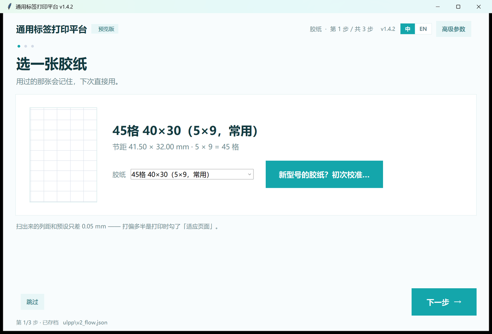
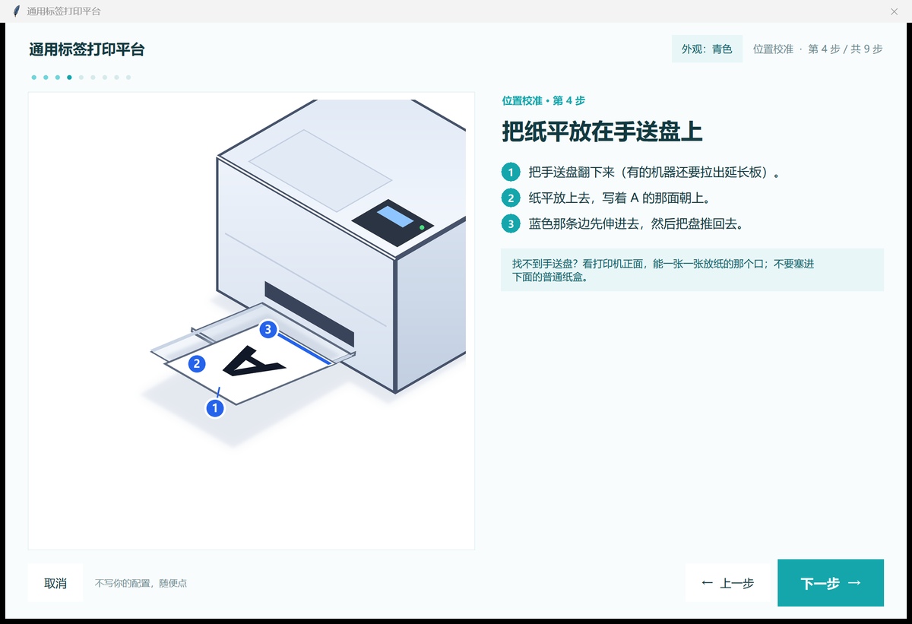
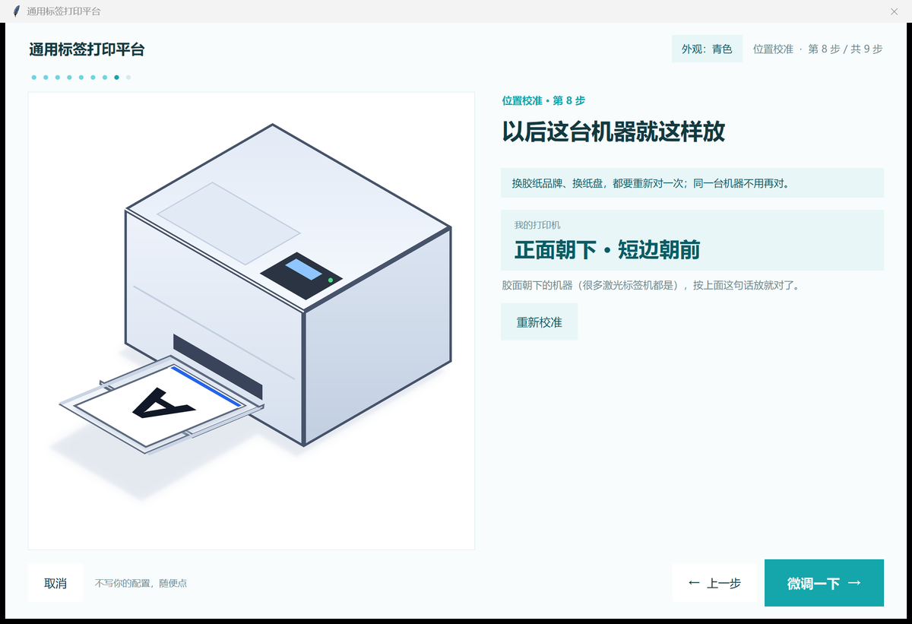
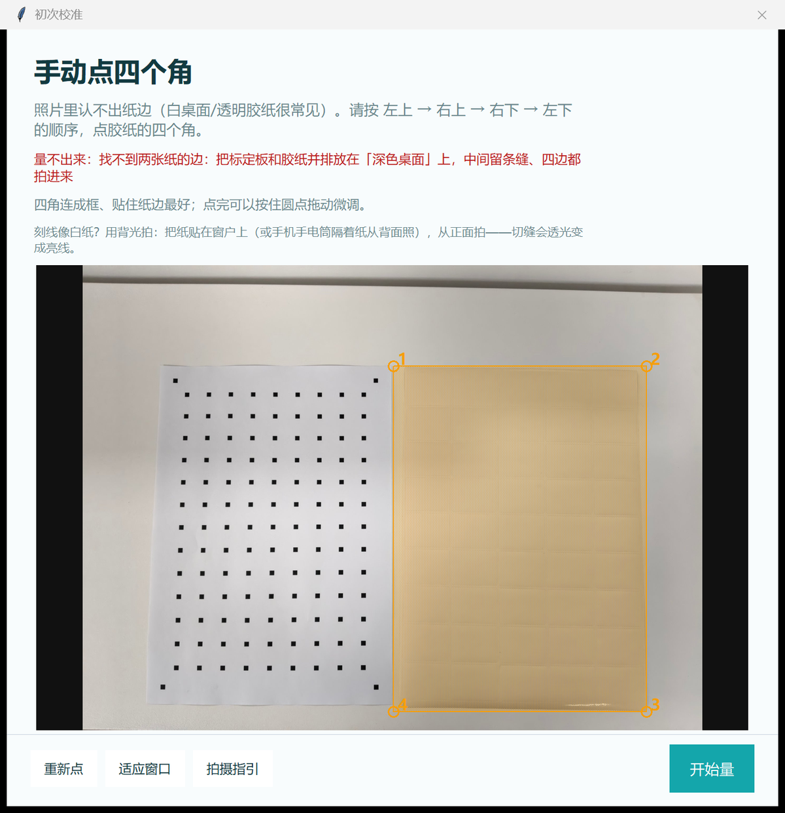

# Universal Label Printing Platform · ulpp

[简体中文](README.md)


Turn **blocks on a PDF page** or a **list of lines** into a print-ready PDF, tiled into A4
pre-cut label sheets at the right quantities. Fully offline, no AI services, no drivers;
on Windows just double-click the exe.

> Born out of manual label layout drudgery — it can now measure your label sheet and remember
> the half-used sheet you left behind.

<p align="center">
  <br>
  <sub>Pick a sheet → add content → generate (v2 preview UI)</sub>
</p>

---

## Contents

- [Quick start](#quick-start)
- [What it does](#what-it-does)
- [UI](#ui)
- [Supported label sheets](#supported-label-sheets)
- [Resuming a half-used sheet](#resuming-a-half-used-sheet)
- [Feed-orientation wizard](#feed-orientation-wizard)
- [Output files](#output-files)
- [v2 preview](#v2-preview)
- [FAQ](#faq)
- [Development & packaging](#development--packaging)
- [Platforms](#platforms)
- [License](#license)

---

## Quick start

| Option | For | How |
|---|---|---|
| **① Download the exe** | No Python setup | Grab `ulpp-<tag>-full-windows-x64.zip` (recommended, includes photo measuring) or `ulpp.exe` (lightweight) from [Releases](../../releases), unzip/run |
| **② Run from source** | Hackers, macOS, Linux | `pip install -r requirements.txt` → `pip install -e .` → `python -m ulpp` |
| **③ Command line** | Batch / scheduled | `python -m ulpp forms.zip -o outdir` |

```bash
git clone https://github.com/Imensama/ulpp.git
cd ulpp
pip install -r requirements.txt
pip install -e .
python -m ulpp            # GUI
python -m ulpp -h         # full CLI help
python -m ulpp --v2       # new shell (preview)
python -m ulpp --lang en  # force English UI
```

---

## What it does

| Capability | Detail |
| --- | --- |
| **Quantity copies** | Reads “Qty 2” and prints two; up to ten for “Qty 10” |
| **Vector clipping** | Each cell is clipped from the source page as vector — stays sharp |
| **Auto text layout** | Wraps, picks font size, align left/center/right, optional uniform size |
| **Quantity syntax** | A line ending in `\|2` or ` ×2` prints twice (`120×80×6` sizes are not mistaken) |
| **Mixed content** | PDF cards first, then text labels, filling one sheet |
| **Three outputs** | Print version, grid-reference version, label list CSV |
| **Bilingual UI** | Switch 中/EN in-app, or `--lang zh\|en`; output filenames follow |
| **Inputs** | PDF / folder / ZIP (Chinese filenames auto-corrected), drag & drop if `tkinterdnd2` is installed |

<p align="center">
  <br>
  <sub>PDF cards: each cell is clipped as vector and scaled into the label</sub>
</p>

---

## UI

Four blocks: **① add PDFs** (optional) → **② text labels** (optional) → **③ options** → **④ sheet spec**,
then **Generate**.

- Drag files/folders into the window if `tkinterdnd2` is installed
- Text labels: one per line; trailing `|2` prints two copies
- Keep “grid reference” checked: print it on plain paper and hold it against the real sheet
- `中 / EN` switch in the header changes the whole UI immediately

---

## Supported label sheets

14 built-in layouts; custom columns/rows/cell size/pitch/margins are also allowed.

| Preset | Col×Row | Cell | Preset | Col×Row | Cell |
| --- | --- | --- | --- | --- | --- |
| 45-up | 5×9 | 40 × 30 mm (pitch 41.5×32) | 40-up | 4×10 | 48 × 25 mm |
| 24-up | 3×8 | 70 × 37 mm | 72-up | 6×12 | 33 × 23 mm |
| 21-up | 3×7 | 70 × 42.3 mm | 65-up | 5×13 | 38 × 22 mm |
| 30-up | 3×10 | 70 × 29.7 mm | 44-up | 4×11 | 46 × 25 mm |
| 12-up | 2×6 | 99 × 49.5 mm | 10-up | 2×5 | 99 × 59.4 mm |
| 8-up | 2×4 | 99 × 74.25 mm | 6-up | 2×3 | 99 × 99 mm |
| 4-up | 2×2 | 105 × 148.5 mm | 2-up | 1×2 | 210 × 148.5 mm |

> Die-cut positions differ by 0.5–1 mm between batches. Print the grid reference first and adjust
> row pitch / top margin / safe margin. CLI accepts stable ids: `--preset 45`.

---

## Resuming a half-used sheet

Bottom-right **Resume…** opens a separate window (the normal flow is untouched).

1. **Create the half-used sheet**: pick a preset, or type columns/rows/cell/pitch
2. **Mark used cells**: right-click to grey them out (right-click again to undo)
3. **Place content**: select an item, left-click a free cell; or “fill all free cells”
4. **Generate**: only the selected cells are printed; other positions stay blank — print at **100%**
5. **Mark used** after printing; one-step undo if you slip

Records live in `%APPDATA%\ulpp\sheets.json` (macOS/Linux: `~/.config/ulpp/sheets.json`);
old `inventory.json` is migrated automatically.

**Limits**: only cells whose labels are still attached can be printed; consumer printers have
±1–2 mm re-feed error; laser preferred (inkjet may smudge on used liner).

---

## Feed-orientation wizard

“Face up or face down, which edge goes in first” differs per printer and the manual is often wrong.
The wizard turns it into two questions anyone can answer.

Entry: **Resume** → orientation & feed → **Not sure? Use the wizard…**

<p align="center">
  
  
</p>

Nine steps: pick printer → write a big “A” → confirm the inked face → load the manual tray (animated) →
print a test page → ask “which face has ink” → ask “which edge has the TOP arrow” → result → fine-tune.
Always print the test page at **100% / actual size**.

---

## Output files

| File | Purpose |
| --- | --- |
| `*_print.pdf` | Print directly onto the label sheet (no grid lines) |
| `*_grid-reference.pdf` | Print on plain paper to check alignment |
| `*_label-list.csv` | Sheet/cell/source/name/qty for every label |
| `*_resume.pdf` | Only the free cells of a half-used sheet |
| `*_resume-list.csv` | Cell list for the resume job |

> Chinese UI uses `*_打印版.pdf`, `*_网格参考版.pdf`, `*_标签清单.csv`, `*_接着打.pdf`.

---

## v2 preview

```powershell
python -m ulpp --v2
```

The classic UI is untouched (`python -m ulpp`). What's new:

- **First-time calibration**: two binary questions (scanner? / A4 to print on?), one next-step at a time
- **Measuring from photos**: print a calibration board, take one photo — or tap the four corners
  (wheel to zoom, drag to pan, drag a dot to fine-tune)
- **Design notes**: [`docs/design/`](docs/design/) — why one photo tops out at 0.3–0.5 mm

<p align="center">
  
  
</p>
<p align="center"><sub>First-time calibration (left) · tapping four corners (right)</sub></p>

---

## FAQ

<details>
<summary><b>No cards detected?</b></summary>

This mode targets “one record per cell” table PDFs. Scans (full-page images) or PDFs without the
expected field names won't parse — use the text mode, or change the field names at the top of
`parser.py`.
</details>

<details>
<summary><b>Font size keeps changing?</b></summary>

By default each label is filled as much as possible; tick “uniform size” to force one size per batch.
</details>

<details>
<summary><b>A label is blank or shows a thin strip?</b></summary>

Usually a table line was treated as content. Open an issue with the PDF, or try `--inset 1`.
</details>

<details>
<summary><b>Cells don't line up?</b></summary>

Print the grid-reference version, measure the offset, adjust row pitch and top margin — or pick a
closer preset. For resume jobs, print the calibration page on plain paper first.
</details>

<details>
<summary><b>Barcodes / QR codes?</b></summary>

Not generated; whatever exists in the source PDF is carried over as-is.
</details>

---

## Development & packaging

```bash
pip install -r requirements.txt
pip install -e .
python -m unittest discover -s tests -t .      # 768 tests
```

```powershell
powershell -ExecutionPolicy Bypass -File packaging\build.ps1   # lightweight single exe
python -m PyInstaller --noconfirm packaging/ulpp_v2.spec       # full build (includes OpenCV)
```

Tagging `v*` makes GitHub Actions build both artefacts and publish the PyPI package.

---

## Platforms

| Platform | Status | Extra requirements |
| --- | --- | --- |
| Windows 10/11 | Primary, exe provided | — |
| macOS | Runs from source | Python 3.9+ (python.org builds include tkinter) |
| Linux | Runs from source | `python3-tk`; Chinese fonts `fonts-wqy-microhei` |

---

## License

[MIT](LICENSE). All third-party components use permissive licenses (MIT / BSD / PSF / MIT-CMU)
and can be redistributed with the exe. See [THIRD-PARTY-NOTICES.md](THIRD-PARTY-NOTICES.md).
